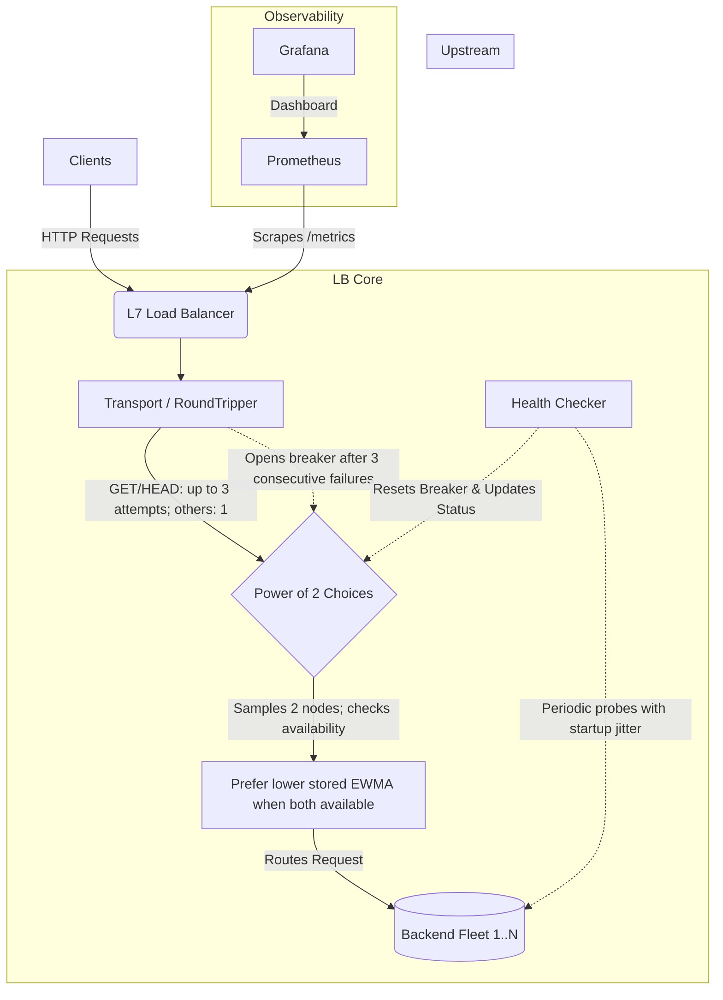
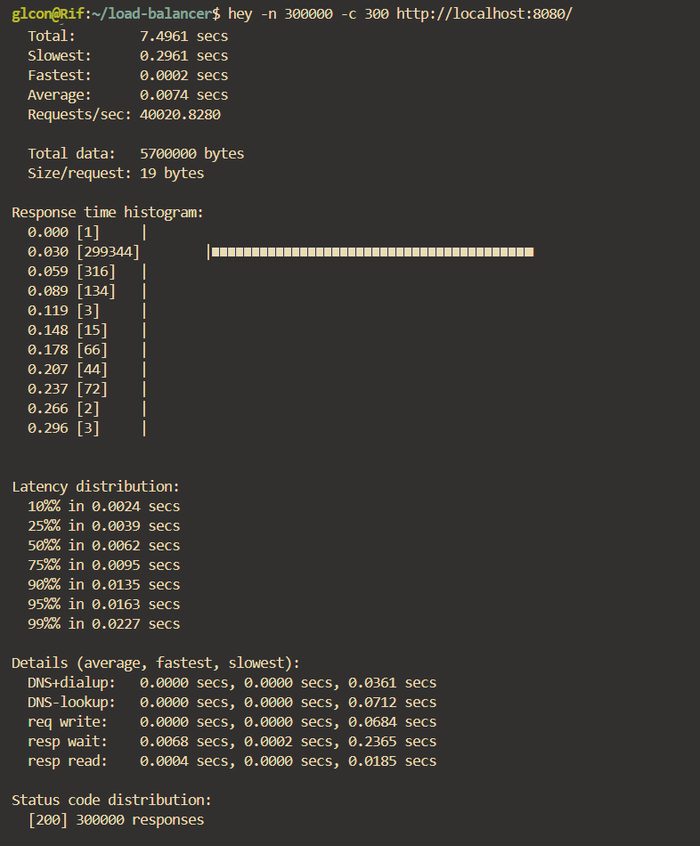
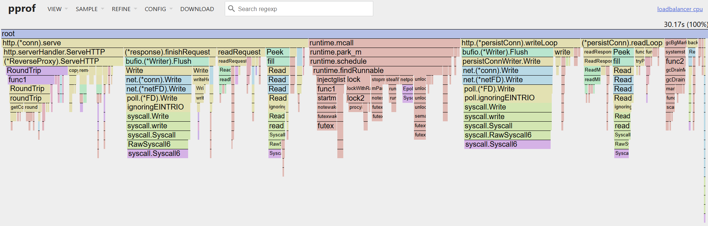
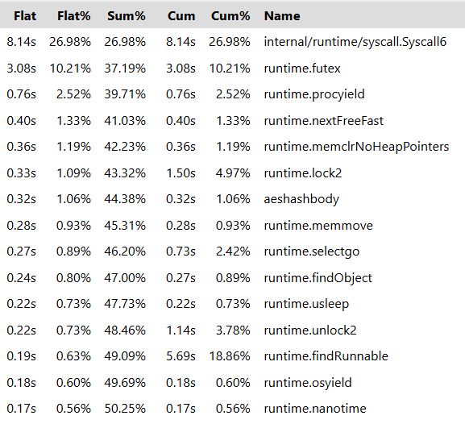
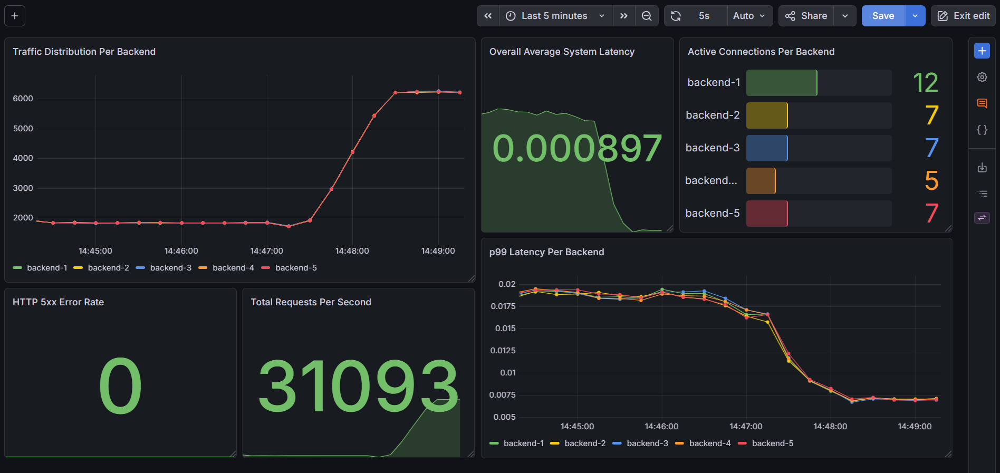

# P2C Load Balancer

A concurrent Layer 7 load balancer written in Go. Designed with Power of Two Choices, EWMA latency scoring, active health checks, per-backend circuit breaking, Prometheus metrics, and backend membership reloads via SIGHUP.


## Architecture & Design



### 1. Power of Two Choices (P2C) with EWMA
This balancer uses a **power of two choices** algorithm. For every request, the LB randomly selects two healthy backends, computes an **exponentially weighted moving average** of request latencies for both, and chooses the one with the faster response time. This ensures latency spikes are smoothed out and the LB reacts to actual degradation rather than micro-spikes.

### 2. Active Health Checking
Each backend has a health-check goroutine that requests `/health` with a 500 ms timeout. If it fails a check, it is marked as unavailable. It will remain out of the pool until it returns a `2xx` to the health-checker. 

Additionally, to prevent overwhelming backends on startup, the `healthLoop` implements randomized jitter (up to 3 seconds) before initiating the first probe. 

Active health checks are essential for reintroducing backends that have been taken out of the selection pool. Pinging backends that haven't seen traffic in a while is also a great way to ensure they haven't become inoperative in the background.

### 3. Circuit Breaking & Transparent Retries
If a backend fails 3 times, its `CircuitState` value is set to `stateOpen`, preventing it from receiving traffic until it is determined healthy again by its health routine. HTTP 500 isn't counted because it is often an application-level error, rather than an unhealthy backend -- this can be configured.

After 3 attempts at backend selection, the user's request will  error out and be sent to the standard logger. This process ensures that hitting a faulty backend doesn't cause the request to fail immediately.

It is also very important to only retry idempotent requests. If we allow a `POST` to retry, it might go through twice, and if the action it performs happens to be charging a credit card, for example, that introduces major problems.

### 4. Hot Swapping
Sending a `SIGHUP` to the program will cause it to update the list of backends to match `config.yml`'s state at that time without restarting the listener.

Removed backends are excluded from the registry immediately, and a background cleanup routine waits for header responses to drop to 0 before stopping the health checking routine. Note: Response bodies might not have finished streaming, and conenctions are not forcibly closed.

### 5. Avoidance of Mutex Use
The balancer's core routing state was designed to avoid application level mutexes during backend selection. If two goroutines fight over a mutex, the losing goroutine is suspended by the Go scheduler and the OS often has to context switch, which is expensive. To modify values in the hot path, atomics are used instead -- they use low-level CPU instructions to modify memory without descheduling the thread, which saves overhead.

Mutexes will still show up on the CPU profile, though, as connection pooling, Prometheus, etc. still need to use them.

## Benchmarks
I used `hey`, Go’s profiling tools, and Grafana to measure throughput and latency, investigate CPU and allocation costs, and observe traffic distribution across backends. Since the load generator, balancer, and backends were all run on the same computer, the measurements aren't representative of the balancer's maximum capacity.

### Throughput & Latency (`hey`)
We can run the `hey` command below to simulate 300 concurrent workers sending in a total of 300000 requests. 

```bash
hey -n 300000 -c 300 http://localhost:8080/
```

I was able to achieve  about ~40k RPS with a ~20ms p99 latency on average across 10 trial runs, one of which is shown below.



### CPU & Goroutine Profiling
I used `pprof` to investigate where the balancer spends CPU time under load. In the flame graph below, wider frames represent more used CPU time, which also includes time spent in the functions they called.



The image below details the top 10 functions by CPU usage time.



We can see that HTTP transport, network-write paths, and runtime scheduling account for the largest portions of the profile. This shows that my backend selection logic is not a prominent CPU user in this usage capture -- the profile is very consistent with the standard overhead of receiving and forwarding HTTP traffic.

### Observability (Grafana)
Every routing decision also reports metrics. The included dashboard shows 6 critical statistics: traffic distribution per backend, HTTP 5xx error rate, active connections per backend, total requests per second, p99 latency per backend, and overall average system latency.



## Run It Yourself

### Prerequisites
- **Go 1.21+**
- **Make** — Windows users should use WSL
- **Docker with the Compose plugin**

### Running Locally
1. Clone the repository and download dependencies:
   ```bash
   git clone https://github.com/glcon/load-balancer.git
   cd load-balancer
   go mod download
   ```

2. Spin up the full cluster (Load Balancer, 5× Nginx backends, Prometheus, Grafana):
   ```bash
   make infra-up
   ```
   The first run will build the Go binary inside Docker, which may take 30–60 seconds.

3. Test the balancer:
   ```bash
   curl http://localhost:8080/
   ```
   For load testing, install [`hey`](https://github.com/rakyll/hey) and run:
   ```bash
   hey -z 15s -c 200 http://localhost:8080/
   ```

4. View metrics:
   - **Grafana** dashboard: `http://localhost:3000` (may take ~10 seconds to come up). Navigate to **Dashboards** and open **lb-dashboard**. Set the time range to **Last 5 minutes** and enable **auto-refresh** to stream live stats.
   - **Prometheus** UI if you'd like it: `http://localhost:9091`
   - **pprof HTML index**: `http://localhost:6060/debug/pprof/` -- live goroutine counts, heap usage, and thread stats.
   - To capture a CPU flame graph under load, run this in a separate terminal:
      ```bash
      go tool pprof -http=:8888 http://localhost:6060/debug/pprof/profile?seconds=10
      ```

5. Tear down:
   ```bash
   make infra-down
   ```

### Other Makefile targets
Run `make help` in the project root to see other actions, including `make test` (runs the unit test suite with the race detector) and `make run` (runs the balancer locally without Docker).

## Configuration
Managed via `configs/config.yml`:

```yaml
listen_addr: ":8080"
metrics_addr: ":9090"
pprof_addr: ":6060"
health_check_interval: 5
backends:
  - id: "backend-1"
    url: "http://backend1:5678"
  - id: "backend-2"
    url: "http://backend2:5678"
  # ... Add as many targets as needed
```

## Future Improvements
- **Layer 4 (TCP) Balancing:** Right now, this is strictly an L7 balancer. I'd love to drop down a level and add raw socket routing capabilities to handle arbitrary TCP traffic as well.
- **Dynamic Service Discovery:** While the hot-swapping feature works well, integrating with something like Consul or etcd would allow backends to dynamically register and deregister themselves so I don't have to touch the `config.yml` at all.
- **Consistent Hashing:** It would be great to introduce a routing strategy based on client headers or IPs to guarantee sticky sessions. This would be incredibly useful for specific tenants that need to always hit the same backend state or cache.
